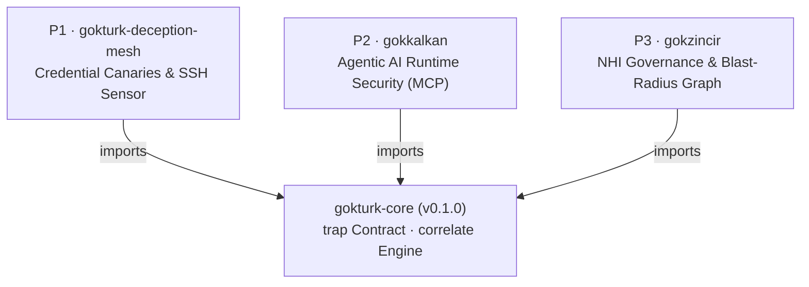

<div align="center">

# gokturk-core

**Shared Go Kernel for the Göktürk Security Platform**

[](https://go.dev/)
[](https://github.com/GokturkFK/gokturk-core)
[](https://github.com/GokturkFK/gokturk-core)
[](https://github.com/GokturkFK)

*Frozen wire contracts (`trap`) and deterministic zero-false-positive campaign correlation (`correlate`) powering every product in the Göktürk platform.*

</div>

---

## Overview

**`gokturk-core`** is the shared Go kernel imported across the Göktürk security ecosystem. It is intentionally **not** a standalone product—it defines the minimal, version-locked backbone that every platform pillar extends:

- **`trap`:** Lifecycle contract (`Provider`, `TripEvent`, `Trap`, `Artifacts`, `Decoder`, `ErrNotATrip`). Concrete trap implementations (credential canaries, agent honeypots, decoy NHIs) live inside their respective product repositories and implement these interfaces.
- **`correlate`:** Deterministic correlation engine (`Evaluate(trips, technique)`). Produces a single alert per source with **zero ML/anomaly noise**: a single verified trip raises a **High** alert, while ≥2 trips from the same source merge into a single **Critical** campaign alert. The caller supplies the MITRE ATT&CK / ATLAS `technique` ID.

---

## Platform Ecosystem



| Pillar | Repository | Domain | Status |
| :---: | :--- | :--- | :--- |
| **P1** | [**`gokturk-deception-mesh`**](https://github.com/GokturkFK/gokturk-deception-mesh) | Credential canary deception & SSH detection | ✅ v0.1 complete |
| **P2** | [**`gokkalkan`**](https://github.com/GokturkFK/gokkalkan) | Agentic AI runtime security (MCP egress proxy + honeypot) | ✅ End-to-end complete |
| **P3** | [**`gokzincir`**](https://github.com/GokturkFK/gokzincir) | Non-Human Identity (NHI) governance & blast-radius graph | ✅ End-to-end complete |

---

## Wire Contract Stability

Types in `trap`—especially the JSON field names of `TripEvent`—constitute a **frozen wire contract** (`v0.1.0`). Breaking schema changes are never made in place; they require a new versioned subject (e.g., `trip.events.v2`) so downstream consumers remain backward-compatible.

---

## Usage

```sh
go get github.com/GokturkFK/gokturk-core
```

```go
package main

import (
    "github.com/GokturkFK/gokturk-core/correlate"
    "github.com/GokturkFK/gokturk-core/trap"
)

func evaluate(trips []trap.TripEvent) []correlate.Alert {
    return correlate.Evaluate(trips, "T1078")
}
```

---

## Development & Verification

```sh
go build ./...
go vet ./...
go test -race ./...
```

---

## Ownership

- `trap` & `correlate` security kernel: [@fetihcakmak](https://github.com/fetihcakmak)
- CI & repository tooling: [@uzunkubra50](https://github.com/uzunkubra50)
- Detailed ownership rules: [`CODEOWNERS`](CODEOWNERS)

---

<div align="center">
  <sub>Part of the <a href="https://github.com/GokturkFK">GokturkFK</a> Security Platform</sub>
</div>
